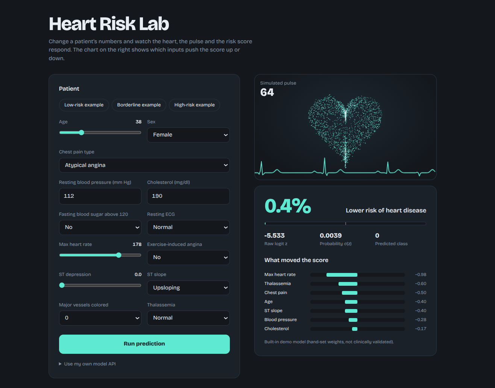
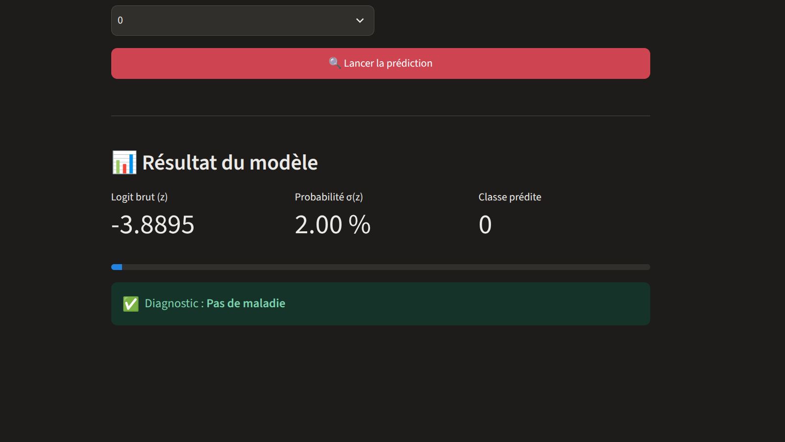
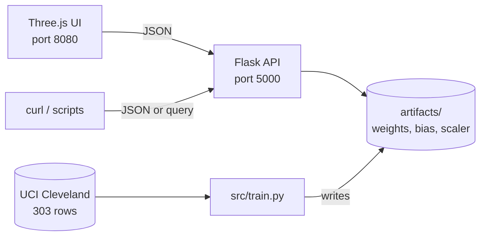

# Heart Disease Prediction: Logistic Regression From Scratch + Flask API


A binary logistic regression classifier written **from scratch** (no `sklearn.linear_model`), trained on the UCI Cleveland Heart Disease dataset and served through a REST API with an interactive Three.js front end.

**Goal:** go beyond a notebook. Train a model, save its artifacts, expose it as an API, and put a usable interface on top of it.

> **Disclaimer:** this is an educational project. It is not a medical device and must not be used for diagnosis or treatment decisions.

---

## Table of contents

1. [Screenshots](#screenshots)
2. [Features](#features)
3. [Architecture](#architecture)
4. [Quick start](#quick-start)
5. [Project structure](#project-structure)
6. [Model details](#model-details)
7. [Input reference](#input-reference)
8. [API reference](#api-reference)
9. [Client examples](#client-examples)
10. [Testing](#testing)
11. [Limitations](#limitations)
12. [Roadmap](#roadmap)

---

## Screenshots

| Screen | Preview |
|--------|---------|
| Three.js interactive UI |  |
| UI, healthy prediction |  |
| UI, disease prediction |  |
| API output, no disease |  |
| API output, disease |  |
| Flask server terminal |  |
| Development environment |  |

---

## Features

- **From-scratch model:** the logit, sigmoid and training loop are implemented directly with NumPy.
- **Complete pipeline:** standardization, prediction and thresholding are saved and reused at inference time, so training and serving never drift apart.
- **REST API:** `/health` and `/predict`, with both JSON (POST) and query-string (GET) input.
- **Interactive UI:** a Three.js heart that reacts to the result, with a form for the 13 clinical inputs.
- **Tested:** unit, integration and functional tests run with `pytest`.

---

## Architecture



Prediction path inside the API:

```
raw input (13 features)
   -> StandardScaler        x' = (x - mu) / sigma
   -> logit                 z  = x'^T w + b
   -> sigmoid               p  = 1 / (1 + e^(-z))
   -> threshold             y  = 1 if p >= 0.5 else 0
```

---

## Quick start

```bash
# 1. Install dependencies
pip install -r requirements.txt

# 2. Train the model (writes artifacts/)
python src/train.py

# 3. Start the API on port 5000
python -m api.server

# 4. Serve the UI on port 8080
cd ui && python -m http.server 8080
# then open http://localhost:8080
```

Check that the API is up:

```bash
curl http://localhost:5000/health
```

---

## Project structure

```
.
├── api/
│   └── server.py        # Flask REST API: GET /health, GET and POST /predict
├── ui/
│   └── index.html       # Three.js interactive front end
├── src/
│   └── train.py         # Training pipeline (from-scratch logistic regression)
├── artifacts/           # Generated: weights, bias, scaler
├── tests/               # Unit, integration and functional tests
├── screenshots/         # Images used in this README
└── requirements.txt
```

---

## Model details

| Item | Value |
|------|-------|
| Task | Binary classification (disease present or absent) |
| Algorithm | Logistic regression, implemented from scratch |
| Dataset | UCI Cleveland Heart Disease, 303 samples |
| Features | 13 clinical variables |
| Preprocessing | StandardScaler (mean and standard deviation learned on the training data) |
| Decision threshold | 0.5 |

**Equations**

```
z    = x^T w + b
p    = sigma(z) = 1 / (1 + e^(-z))
loss = -(1/n) * sum( y*log(p) + (1-y)*log(1-p) )
```

<!-- Fill in with your real numbers from train.py -->

**Training configuration** (edit to match `src/train.py`)

| Setting | Value |
|---------|-------|
| Optimizer | Gradient descent |
| Learning rate | _fill in_ |
| Iterations | _fill in_ |
| Train / test split | _fill in_ |
| Regularization | _none, or fill in_ |

**Results on the held-out set** (fill in after training)

| Metric | Value |
|--------|-------|
| Accuracy | _fill in_ |
| Precision | _fill in_ |
| Recall | _fill in_ |
| F1 score | _fill in_ |

For a medical-style task, recall (how many true cases are caught) matters at least as much as accuracy, so report both.

---

## Input reference

All 13 fields are required.

| Field | Meaning | Type | Values |
|-------|---------|------|--------|
| `age` | Age in years | number | e.g. 29 to 77 |
| `sex` | Sex | integer | 1 = male, 0 = female |
| `cp` | Chest pain type | integer | category code |
| `trestbps` | Resting blood pressure (mm Hg) | number | e.g. 94 to 200 |
| `chol` | Serum cholesterol (mg/dl) | number | e.g. 126 to 564 |
| `fbs` | Fasting blood sugar above 120 mg/dl | integer | 1 = yes, 0 = no |
| `restecg` | Resting ECG result | integer | category code |
| `thalach` | Maximum heart rate achieved | number | e.g. 71 to 202 |
| `exang` | Exercise-induced angina | integer | 1 = yes, 0 = no |
| `oldpeak` | ST depression induced by exercise | number | e.g. 0 to 6.2 |
| `slope` | Slope of the peak exercise ST segment | integer | category code |
| `ca` | Major vessels colored by fluoroscopy | integer | 0 to 3 |
| `thal` | Thalassemia | integer | category code |

> **Check your encoding.** The original UCI file codes some categories differently from many CSV copies (for example `cp` is 1 to 4 in the raw UCI data and 0 to 3 in several re-published versions). Document the exact coding your `train.py` expects, and keep the UI dropdowns identical to it.

---

## API reference

Base URL: `http://localhost:5000`

| Method | Endpoint | Description |
|--------|----------|-------------|
| GET | `/health` | Health check |
| POST | `/predict` | Prediction from a JSON body |
| GET | `/predict` | Prediction from query parameters |

### POST /predict

```bash
curl -X POST http://localhost:5000/predict \
  -H "Content-Type: application/json" \
  -d '{"age":52,"sex":1,"cp":0,"trestbps":125,"chol":212,"fbs":0,"restecg":0,"thalach":168,"exang":0,"oldpeak":1.0,"slope":2,"ca":0,"thal":2}'
```

### GET /predict

```
http://localhost:5000/predict?age=52&sex=1&cp=0&trestbps=125&chol=212&fbs=0&restecg=0&thalach=168&exang=0&oldpeak=1.0&slope=2&ca=0&thal=2
```
### GET /predict from the server :

```
https://backend-heart-app.fly.dev/predict?age=52&sex=1&cp=0&trestbps=125&chol=212&fbs=0&restecg=0&thalach=168&exang=0&oldpeak=1.0&slope=2&ca=0&thal=2

```
### Response

```json
{
  "logit": -1.2345,
  "probability": 0.2241,
  "prediction": 0,
  "label": "Pas de maladie"
}
```

| Field | Description |
|-------|-------------|
| `logit` | Raw score `z` before the sigmoid |
| `probability` | Estimated probability of disease, `sigma(z)` |
| `prediction` | `1` if `probability >= 0.5`, otherwise `0` |
| `label` | Human-readable result (`Pas de maladie` or `Maladie`) |

### Errors

Invalid or missing input should return an HTTP 4xx status with a JSON body such as `{"error": "missing field: chol"}`. The UI shows this message to the user. Align this section with the exact messages in `api/server.py`.

---

## Client examples

**Python**

```python
import requests

patient = {"age": 52, "sex": 1, "cp": 0, "trestbps": 125, "chol": 212,
           "fbs": 0, "restecg": 0, "thalach": 168, "exang": 0,
           "oldpeak": 1.0, "slope": 2, "ca": 0, "thal": 2}

r = requests.post("http://localhost:5000/predict", json=patient, timeout=10)
r.raise_for_status()
print(r.json())
```

**JavaScript**

```js
const res = await fetch("http://localhost:5000/predict", {
  method: "POST",
  headers: { "Content-Type": "application/json" },
  body: JSON.stringify({ age: 52, sex: 1, cp: 0, trestbps: 125, chol: 212,
    fbs: 0, restecg: 0, thalach: 168, exang: 0, oldpeak: 1.0,
    slope: 2, ca: 0, thal: 2 }),
});
console.log(await res.json());
```

If the UI (port 8080) cannot reach the API (port 5000) from the browser, enable CORS in Flask:

```python
from flask_cors import CORS
CORS(app)
```

---

## Testing

```bash
pytest tests/ -v
```

| Level | What it checks |
|-------|----------------|
| Unit | sigmoid, logit, scaler and the training step |
| Integration | saved artifacts load and produce the same output as training |
| Functional | `/health` and `/predict` respond correctly over HTTP |

---

## Limitations

- **Small data:** 303 samples is enough to learn from, not enough for a reliable clinical tool.
- **Single source:** one hospital's data from one period, so it may not generalize to other populations.
- **Linear model:** logistic regression cannot capture feature interactions without engineered features.
- **Not validated clinically:** outputs are probabilities from a teaching model, not medical advice.

---

## Roadmap

- [ ] Add accuracy, recall and ROC-AUC to the README and to `train.py` output
- [ ] Add L2 regularization and compare
- [ ] Input validation with clear error messages for out-of-range values
- [ ] Dockerfile and `docker compose up` for API + UI
- [ ] CI with GitHub Actions running `pytest`
- [ ] Show per-feature contributions in the API response and the UI
- [ ] Optional English labels via a `lang` parameter

---

*GOD Protect ALL enshallah*
