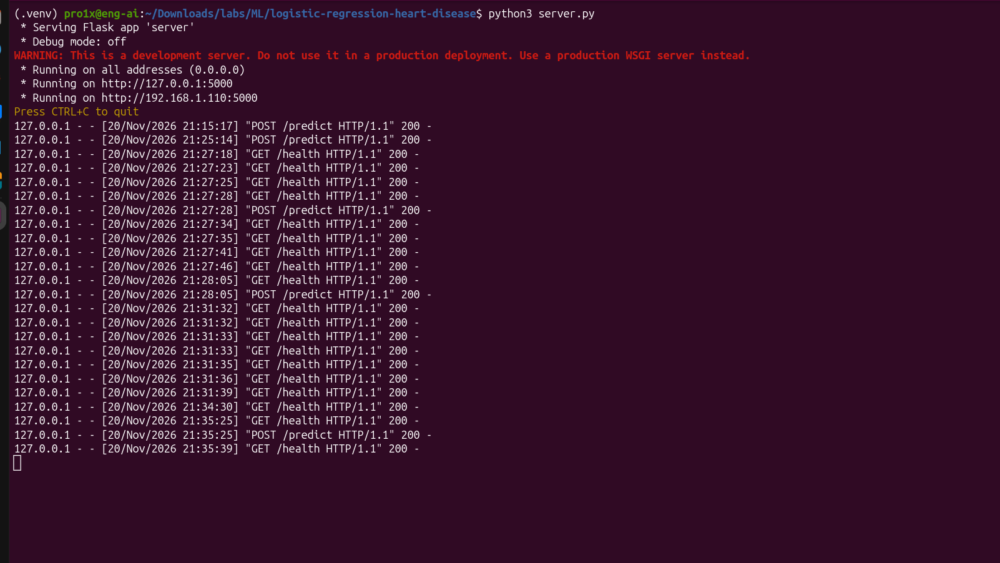

# Logistic Regression — Heart Disease (From Scratch + Flask API)

> Implémentation from scratch de la régression logistique binaire
> sur le dataset UCI Cleveland, déployée en tant qu'API REST.

**Objectif :** entraîner proprement et exposer un modèle Machine Learning utile,
pour préparer un projet concret, réutilisable et prêt à la production.

## 📸 Aperçu

| Écran | Fichier |
|-------|---------|
| Environnement de développement |  |
| Terminal du serveur Flask |  |
| Interface utilisateur (saine) |  |
| Interface utilisateur (malade) |  |
| Prédiction — pas de maladie |  |
| Prédiction — maladie |  |

# GOD Protect ALL enshallah