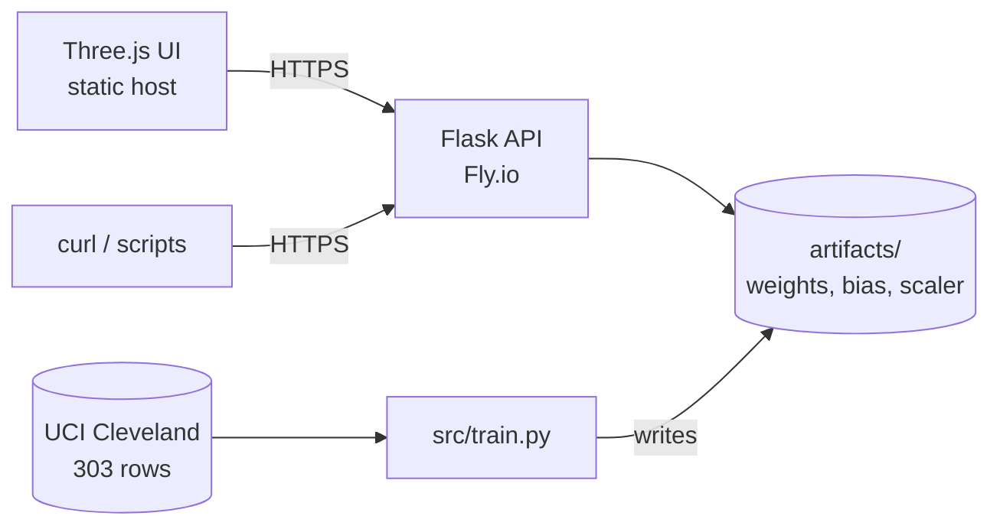

# Heart Disease Prediction — From-Scratch Logistic Regression + Flask API + Three.js UI


A binary logistic regression classifier **implemented from scratch** (no `sklearn.linear_model`), trained on the UCI Cleveland Heart Disease dataset, served via REST API, and deployed to **Fly.io** with an interactive Three.js front end.

> **Disclaimer:** Educational project. Not a medical device. Do not use for diagnosis.

---

## 🚀 Live Demo

| Component | URL |
|-----------|-----|
| **API (Fly.io)** | `https://backend-heart-app.fly.dev` |
| `GET /health` | [health](https://backend-heart-app.fly.dev/health) |
| `GET /predict` | [example](https://backend-heart-app.fly.dev/predict?age=52&sex=1&cp=0&trestbps=125&chol=212&fbs=0&restecg=0&thalach=168&exang=0&oldpeak=1.0&slope=2&ca=0&thal=2) |
| **UI** | Deploy `ui/dist/` to any static host (Netlify, Vercel, GitHub Pages) |

---

## ✨ Features

- **From-scratch model:** logit, sigmoid, gradient descent training loop in pure NumPy
- **Reproducible pipeline:** StandardScaler + weights + bias saved to `artifacts/`, reused at inference
- **REST API:** `/health`, `POST /predict` (JSON), `GET /predict` (query params)
- **Interactive UI:** Three.js animated heart + ECG, 13 clinical inputs, live risk visualization
- **Tested:** unit, integration, functional tests (`pytest`)

---

## 🏗 Architecture



**Inference pipeline:**
```
raw input (13 features)
  -> StandardScaler    x' = (x - μ) / σ
  -> logit             z  = x'ᵀw + b
  -> sigmoid           p  = 1 / (1 + e^(-z))
  -> threshold         ŷ  = 1 if p ≥ 0.5 else 0
```

---

## 🏃 Quick Start (Local)

```bash
# 1. Install deps
pip install -r requirements.txt

# 2. Train (generates artifacts/)
python src/train.py

# 3. Run API locally (port 5000)
python -m api.server

# 4. Build & serve UI (port 8080)
cd ui && python build.py && python -m http.server 8080 --directory dist
```

---

## 📁 Project Structure

```
.
├── api/server.py          # Flask API: GET /health, GET|POST /predict
├── ui/
│   ├── index.html         # Three.js front end (source)
│   ├── build.py           # Injects API_BASE from .env → dist/index.html
│   ├── .env               # local: API_BASE=http://localhost:5000 (gitignored)
│   └── .env.production    # template: API_BASE=https://backend-heart-app.fly.dev
├── src/train.py           # From-scratch training pipeline
├── artifacts/             # model_weights.pkl, model_bias.pkl, scaler.pkl
├── tests/                 # unit, integration, functional
└── requirements.txt
```

---

## 🌐 API Reference

| Method | Endpoint | Description |
|--------|----------|-------------|
| GET | `/health` | Health check |
| POST | `/predict` | JSON body with 13 features |
| GET | `/predict` | Query params with 13 features |

**Example (GET):**
```
https://backend-heart-app.fly.dev/predict?age=52&sex=1&cp=0&trestbps=125&chol=212&fbs=0&restecg=0&thalach=168&exang=0&oldpeak=1.0&slope=2&ca=0&thal=2
```

**Response:**
```json
{
  "logit": -1.2345,
  "probability": 0.2241,
  "prediction": 0,
  "label": "Pas de maladie"
}
```

---

## 🧪 Testing

```bash
pytest tests/ -v
```

| Level | Scope |
|-------|-------|
| Unit | sigmoid, logit, scaler, training step |
| Integration | artifacts load, match training output |
| Functional | HTTP `/health`, `/predict` behavior |

---

## ⚙️ Deployment (MLOps Highlights)

- **Containerized:** `Dockerfile` builds API image
- **Cloud:** Deployed to **Fly.io** (`fly deploy`) with persistent volume for artifacts
- **CORS enabled:** `flask-cors` allows browser UI from any origin
- **Environment-driven UI:** `ui/build.py` injects `API_BASE` at build time (local vs prod)
- **CI-ready:** GitHub Actions can run `pytest` + build UI + deploy

---

## 📊 Model Details

| Item | Value |
|------|-------|
| Task | Binary classification (disease present/absent) |
| Algorithm | Logistic regression (from scratch, NumPy) |
| Data | UCI Cleveland Heart Disease, 303 samples |
| Features | 13 clinical variables |
| Preprocessing | StandardScaler (fit on train, saved) |
| Threshold | 0.5 |

---

## 🗺 Roadmap

- [ ] Add accuracy/recall/ROC-AUC to `train.py` output & README
- [ ] L2 regularization comparison
- [ ] Input validation with clear range errors
- [ ] `docker compose` for local API + UI
- [ ] GitHub Actions CI (test → build → deploy)
- [ ] Per-feature contribution in API response & UI
- [ ] English/French labels via `lang` param

---

*GOD Protect ALL enshallah*