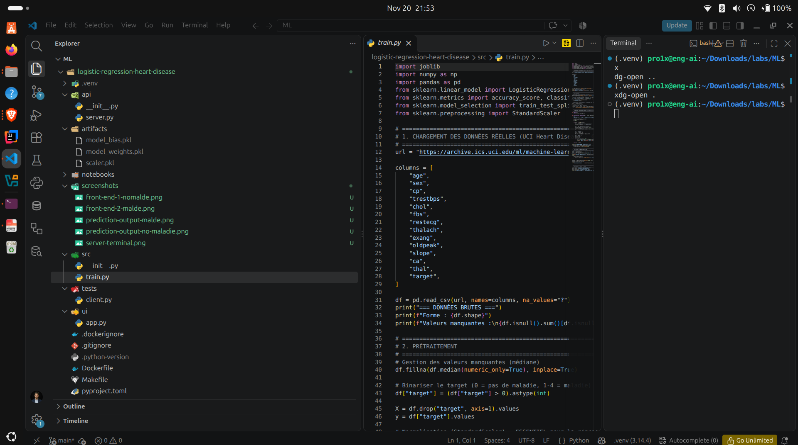
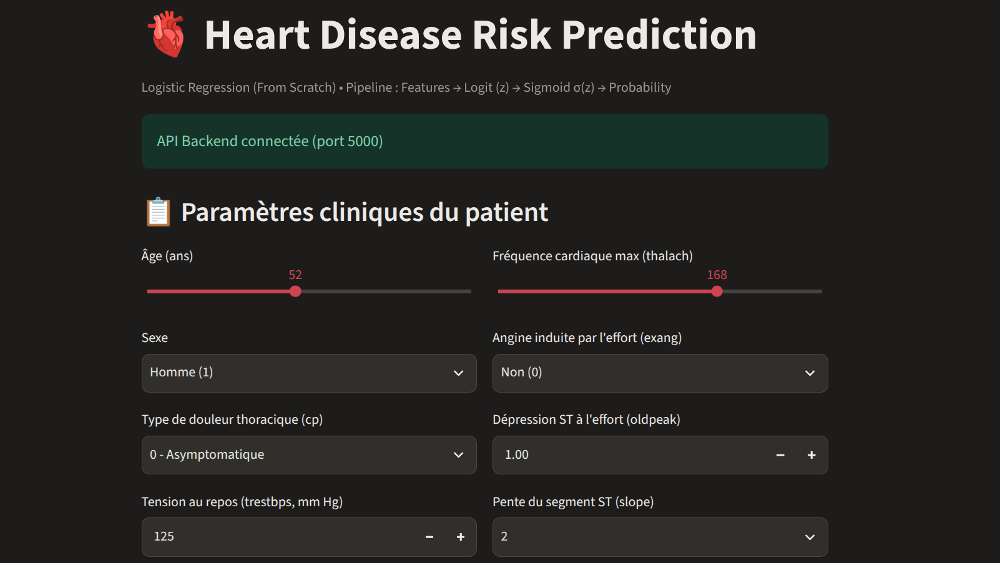
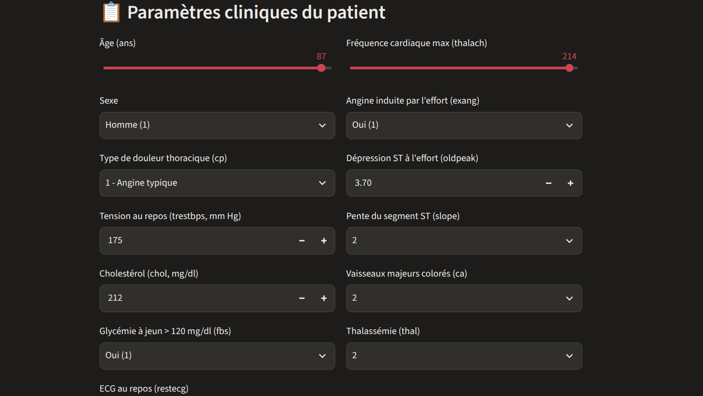
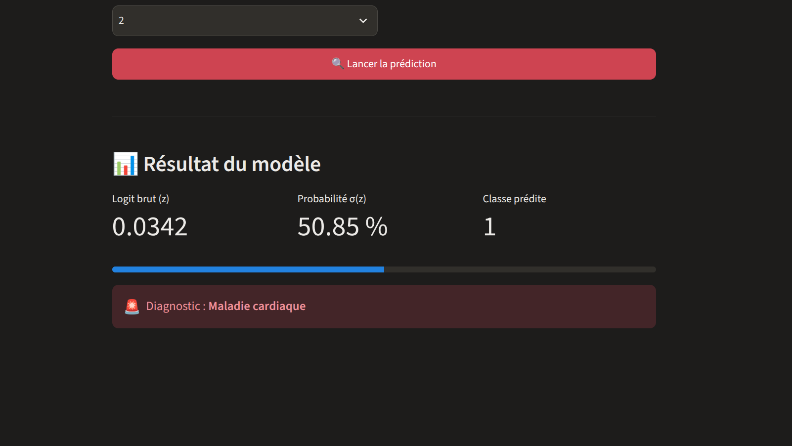

# Logistic Regression — Heart Disease (From Scratch + Flask API)

> From-scratch binary logistic regression on the UCI Cleveland dataset, deployed as a REST API.

**Goal:** Train and expose a usable ML model — concrete, reusable, production-ready.

## 📸 Screenshots

| Screen | Preview |
|--------|---------|
| Dev Environment |  |
| Flask Server Terminal |  |
| **Three.js Interactive UI** |  |
| UI — Healthy Prediction |  |
| UI — Disease Prediction |  |
| Prediction Output — No Disease |  |
| Prediction Output — Disease |  |

## 🚀 Quick Start

```bash
# Install dependencies
pip install -r requirements.txt

# Train model (generates artifacts/)
python src/train.py

# Start API (port 5000)
python -m api.server

# Serve UI (port 8080)
cd ui && python -m http.server 8080
# Open http://localhost:8080
```

## 📁 Project Structure

```
.
├── api/server.py          # Flask REST API (POST/GET /predict, GET /health)
├── ui/index.html          # Three.js interactive frontend
├── src/train.py           # Training pipeline (from-scratch logistic regression)
├── artifacts/             # Model weights, bias, scaler (generated)
├── tests/                 # Unit, integration, functional tests
└── requirements.txt
```

## 🔬 Model Details

- **Algorithm:** Binary logistic regression (from scratch, no sklearn.linear_model)
- **Features:** 13 clinical variables (age, sex, cp, trestbps, chol, fbs, restecg, thalach, exang, oldpeak, slope, ca, thal)
- **Pipeline:** StandardScaler → Logit (z = xᵀw + b) → Sigmoid σ(z) → Threshold 0.5
- **Dataset:** UCI Cleveland Heart Disease (303 samples, 13 features)

## 🌐 API Endpoints

| Method | Endpoint | Description |
|--------|----------|-------------|
| GET | `/health` | Health check |
| POST | `/predict` | Prediction (JSON body) |
| GET | `/predict` | Prediction (query params) |

**POST Example:**
```bash
curl -X POST http://localhost:5000/predict \
  -H "Content-Type: application/json" \
  -d '{"age":52,"sex":1,"cp":0,"trestbps":125,"chol":212,"fbs":0,"restecg":0,"thalach":168,"exang":0,"oldpeak":1.0,"slope":2,"ca":0,"thal":2}'
```

**GET Example:**
```
http://localhost:5000/predict?age=52&sex=1&cp=0&trestbps=125&chol=212&fbs=0&restecg=0&thalach=168&exang=0&oldpeak=1.0&slope=2&ca=0&thal=2
```

**Response:**
```json
{
  "logit": -1.2345,
  "probability": 0.2241,
  "prediction": 0,
  "label": "Pas de maladie"
}
```

## ✅ Testing

```bash
pytest tests/ -v
```

---

*GOD Protect ALL enshallah*